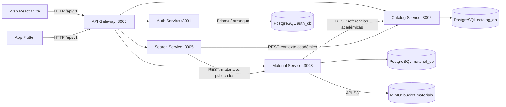
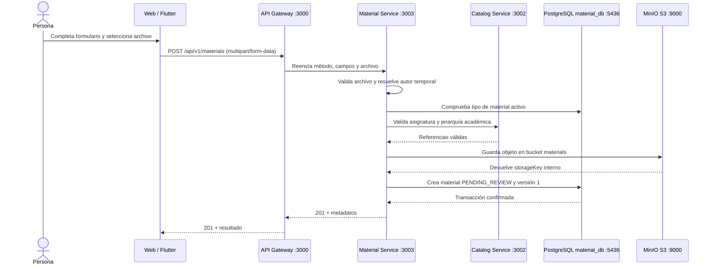

# Guía del flujo de ApuntesUCT

Este documento describe cómo se conectan las aplicaciones, el API Gateway y los
microservicios, con especial atención a la subida y descarga de materiales.
Está basado en la implementación actual; distingue el entorno local del Compose
de despliegue porque sus puertos publicados son diferentes.

## Vista general



Quality tiene reservado el puerto `3004`, pero hoy es solo un servicio pendiente:
no hay una aplicación disponible ni una ruta configurada en el Gateway.

## Puertos

### Desarrollo local

La tabla muestra los puertos del host. El `docker-compose.yml` de la raíz levanta
las bases de datos y MinIO; los procesos Nest y las aplicaciones se inician por
separado.

| Componente | Puerto host | Uso |
| --- | ---: | --- |
| API Gateway | `3000` | Entrada HTTP común para la API |
| Auth Service | `3001` | Identidad y login mock |
| Catalog Service | `3002` | Catálogo académico |
| Material Service | `3003` | Materiales, archivos y versiones |
| Quality Service | `3004` | Reservado; no implementado |
| Search Service | `3005` | Búsquedas y filtros |
| PostgreSQL `db-auth` | `5432` | Base `auth_db` |
| PostgreSQL `db-catalog` | `5433` | Base `catalog_db` |
| PostgreSQL `db-quality` | `5434` | Base `quality_db`; no hay servicio activo |
| PostgreSQL `db-search` | `5435` | Base `search_db`; Search no usa base de datos |
| PostgreSQL `db-material` | `5436` | Base `material_db` |
| MinIO API S3 | `9000` | Almacenamiento de objetos |
| MinIO Console | `9001` | Consola web de MinIO |
| Vite Web | `5173` por defecto | Interfaz web en desarrollo |

En Compose local, los puertos de MinIO se publican solo en `127.0.0.1`. Los
servicios Nest usan el prefijo `/api/v1`, excepto el health de Catalog, que es
`GET http://localhost:3002/health`.

### Compose de despliegue Kubero

En `deploy/kubero/compose.yaml`, el navegador entra por Nginx Web en
`http://localhost:18080` y por defecto el Gateway se publica en
`http://localhost:13000`. Ambos valores se pueden cambiar con `WEB_PORT` y
`GATEWAY_PORT`. Nginx sirve la aplicación y reenvía `/api/` al Gateway.
Los servicios, PostgreSQL y MinIO se comunican por la red interna de Docker;
no publican sus puertos individuales al host.

Así, desde el navegador la base de API de despliegue es
`http://localhost:13000/api/v1`, mientras que en desarrollo web local suele ser
`http://localhost:3000/api/v1`.

## Qué hace cada servicio

| Servicio | Responsabilidad actual | Persistencia / dependencias |
| --- | --- | --- |
| **API Gateway** | Punto de entrada. Reenvía Auth, Catalog, Materials y Search; conserva método, query, cuerpo y cabeceras relevantes. Devuelve `502` si el destino no responde a tiempo. | No requiere base de datos. |
| **Auth** | Tiene el modelo Prisma de usuarios, roles y refresh tokens, pero el endpoint disponible es un login temporal que devuelve una sesión ficticia con un JWT sin firma (`alg: none`). No autentica usuarios ni debe usarse para autorizar peticiones; el registro no está implementado. | PostgreSQL `auth_db` (`5432`); Prisma conecta al iniciar el servicio. |
| **Catalog** | Mantiene universidad → carrera → asignatura → profesor; expone listados, árbol, filtros y operaciones de gestión. Es la fuente de verdad de esas referencias académicas. | PostgreSQL `catalog_db` (`5433`). |
| **Material** | Crea y consulta metadatos de materiales, valida referencias con Catalog, guarda archivos/versiones en MinIO y entrega descargas. Los materiales nuevos quedan `PENDING_REVIEW`. | PostgreSQL `material_db` (`5436`), MinIO (`9000`) y Catalog (`3002`). |
| **Search** | Combina los materiales publicados de Material con el contexto académico de Catalog. Aplica texto, filtros, orden y paginación sin acceder directamente a las bases de datos. | Llama a Material (`3003`) y Catalog (`3002`); no usa PostgreSQL. |
| **Quality** | Servicio planificado/reservado; no implementa revisión ni moderación todavía. | No hay proceso activo. |

Cada servicio con persistencia tiene su propia base de datos. Las referencias
entre servicios son identificadores intercambiados por HTTP, no claves foráneas
compartidas.

## Subida de un archivo, paso a paso

1. **La persona completa el formulario Web.** En la pantalla de subida se
   seleccionan universidad, carrera y asignatura; el catálogo académico se
   consulta por la API. El formulario reúne título, año, tipo, referencias y,
   opcionalmente, profesor y descripción. Para `LINK` se usa una URL en lugar de
   un archivo.
2. **El navegador prepara el multipart.** La Web envía un `FormData` con los
   campos de texto y, para documentos, un único campo binario llamado `file`.
   La petición va a `POST /api/v1/materials` en el Gateway. Flutter también usa
   el Gateway como su única base de API.
3. **El Gateway reenvía la petición.** `/api/v1/materials` pasa a Material
   Service, normalmente en `http://127.0.0.1:3003` en desarrollo. En despliegue,
   el destino es `http://material:3003` dentro de la red Docker.
4. **Material valida la entrada.** Multer acepta como máximo un archivo.
   Material requiere título, año, tipo y `subjectId`; admite PDF, DOC, DOCX,
   PPT y PPTX, y determina el tipo a partir del contenido, no del nombre ni del
   MIME declarado. El máximo es 15 MiB (`15.728.640` bytes); un archivo vacío se
   rechaza. Los tipos `DOCUMENT`, `PRESENTATION`, `EXAM` y `SUMMARY` requieren
   archivo. `LINK` requiere `externalLink` y no admite archivo.
5. **Se obtiene el contexto de autor.** Hoy Material no valida ni interpreta el
   token de Auth. `MaterialAuthorProvider` solo puede resolver un autor cuando
   `NODE_ENV=development`, `MATERIAL_LOCAL_AUTHOR_ENABLED=true` y
   `MATERIAL_LOCAL_UPLOADER_ID` es un UUID válido. En otro caso, la petición
   termina con `401`. La configuración de Kubero lo mantiene deshabilitado.
6. **Se validan tipo y referencias.** Material comprueba que el tipo exista y
   esté activo en su propia base. Luego llama directamente a Catalog por HTTP
   para confirmar que la asignatura (y, si se indicó, carrera/profesor) existe,
   está activa y corresponde a la jerarquía y universidad del autor. Si Catalog
   no está disponible, la subida falla con `502`; las referencias inválidas
   producen `400`. Estas verificaciones ocurren antes de guardar el objeto.
7. **Se guarda el binario.** Material envía el contenido a MinIO por su API S3
   en el puerto `9000`, dentro del bucket `materials`. El objeto recibe una
   clave interna aleatoria; esa clave no se entrega al cliente.
8. **Se persisten los metadatos.** Material crea en PostgreSQL el registro del
   material y su versión inicial (`versionNumber=1`): nombre original, MIME,
   tamaño, checksum SHA-256 y clave interna de almacenamiento. La creación del
   material y su versión se realiza en una transacción. El estado inicial es
   `PENDING_REVIEW`.
9. **La API responde.** Si todo resulta bien, responde `201` con los metadatos
   del material. No devuelve una URL pública de MinIO.



## Después de la subida

- **Revisión/publicación:** los nuevos materiales quedan en `PENDING_REVIEW`.
  El listado público de Material y las búsquedas de Search incluyen materiales
  publicados (`PUBLISHED`), por lo que un material recién subido no aparece
  hasta que otro flujo lo publique. El microservicio Quality y el flujo de
  moderación no están implementados en este momento.
- **Listado:** `GET /api/v1/materials?page=1&pageSize=20` devuelve materiales
  publicados desde Material.
- **Detalle e historial:** `GET /api/v1/materials/:id` devuelve metadatos e
  historial de versiones para materiales publicados.
- **Descarga:** `GET /api/v1/materials/:id/download` resuelve la versión actual
  (o `?versionId=<uuid>`) y Material transmite el objeto desde MinIO. El cliente
  nunca recibe la clave interna del bucket.
- **Nueva versión:** `POST /api/v1/materials/:id/versions` recibe un multipart
  con `file`. Material exige contexto de autor y que sea el autor original;
  agrega una versión numerada sin borrar las anteriores.
- **Búsqueda:** `GET /api/v1/search` consulta Catalog y Material. Puede filtrar
  por texto, año, tipo y referencias académicas; Search compone la respuesta y
  limita a 10.000 materiales la exploración necesaria para consultas filtradas.

## Rutas principales del Gateway

| Ruta pública | Servicio destino | Ejemplos |
| --- | --- | --- |
| `/api/v1/auth/*` | Auth (`3001`) | `POST /auth/login`, `GET /auth/health` |
| `/api/v1/catalog/*` | Catalog (`3002`) | `GET /catalog`, `GET /catalog/subjects` |
| `/api/v1/materials/*` | Material (`3003`) | `POST /materials`, `GET /materials`, `GET /materials/:id/download` |
| `/api/v1/search` | Search (`3005`) | `GET /search?q=...&year=...` |

Para comprobar salud, Gateway/Auth/Material/Search usan
`GET /api/v1/health`; Catalog usa `GET /health`. Estos checks confirman que el
proceso responde, no necesariamente que todas sus dependencias estén operativas.

## Cómo levantar el entorno local

1. Configura las variables locales de MinIO en el `.env` de la raíz a partir de
   `.env.example`; no sobrescribas un `.env` que ya tengas.
2. Desde la raíz, inicia las dependencias:

   ```powershell
   docker compose up -d
   ```

3. Instala las dependencias del backend desde `backend` y genera los clientes
   Prisma según lo indicado en [backend/README.md](backend/README.md).
4. Inicia los procesos Nest en terminales separadas: Gateway `3000`, Auth
   `3001`, Catalog `3002`, Material `3003` y Search `3005`. Material necesita
   `material_db`, migraciones y credenciales de MinIO; sus instrucciones están
   en [backend/material-service/README.md](backend/material-service/README.md).
5. Configura `web/.env` con `VITE_API_URL=http://localhost:3000/api/v1` (el
   archivo de ejemplo ya indica esa base) e inicia Vite desde `web`.
6. Para Flutter, la URL predeterminada es `http://localhost:3000/api/v1`; en
   emulador Android es `http://10.0.2.2:3000/api/v1`. Se puede sobreescribir
   con `API_GATEWAY_URL`.

Para consultar los contratos HTTP, revisa Swagger en
`http://localhost:<puerto>/api/docs` para cada servicio (Gateway publica su
índice en `/api/docs/gateway`).

## Documentación de implementación

- [Backend: puertos y ejecución local](backend/README.md)
- [API Gateway y proxies](backend/api-gateway/README.md)
- [Auth Service](backend/auth-service/README.md)
- [Catalog Service](backend/catalog-service/README.md)
- [Material Service](backend/material-service/README.md)
- [Despliegue Kubero](deploy/kubero/README.md)
- [Integración de API Mobile](docs/mobile/integracion-api-mobile.md)
